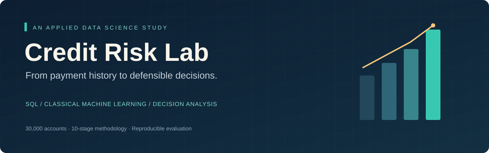
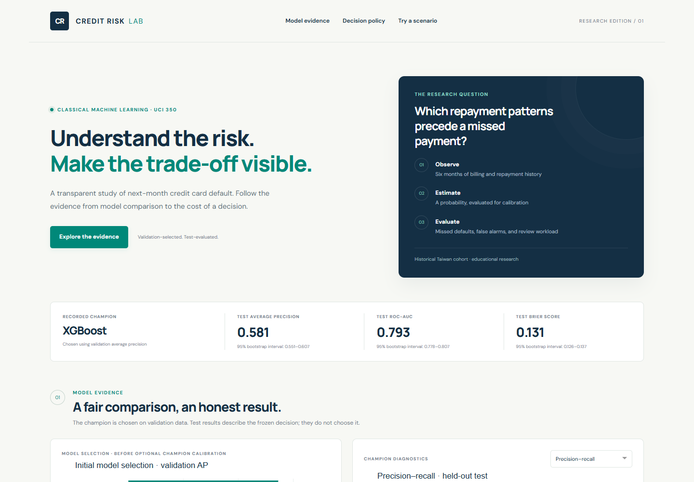
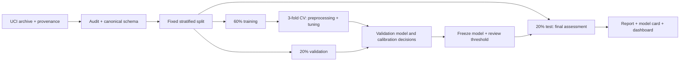

**A complete behavioral credit-risk study using SQL and classical machine learning.**

Python · pandas · SQL · scikit-learn · XGBoost · Plotly Dash · IBM's 10-stage methodology

## The problem

A bank has limited capacity to review existing credit-card accounts. Which accounts
should it prioritize for review next month, and how does that decision change when
missing a default is more costly than an unnecessary review?

This project uses six months of recorded payment behavior for **30,000 accounts**
to predict next-month default. It connects relational data analysis, feature
engineering, model selection, probability calibration and an explicit review policy.
The target is the dataset's default indicator, not an independently verified legal
or regulatory definition of default. Predictions support an educational account-review
scenario, not automated approval, denial or treatment of customers.

**[Read the results](docs/results.md)** · **[Explore the notebooks](notebooks/)** ·
**[Inspect the methodology](docs/methodology.md)** · **[Read the model card](docs/model_card.md)**

## Results at a glance

<!-- RESULTS_START -->
**Validation-selected model: XGBoost.** On 6,000 held-out accounts: average precision **0.581**, ROC-AUC **0.793**, Brier score **0.131**. At the frozen threshold **0.15**, recall is **79.2%** and **48.5%** of accounts are flagged. The threshold uses an illustrative missed-default:false-alarm cost ratio of 5:1.

95% customer-bootstrap intervals: AP 0.551–0.607; ROC-AUC 0.778–0.807. These intervals condition on the fitted model; they do not measure future drift or model-selection uncertainty.
<!-- RESULTS_END -->

The model family is selected on **validation average precision**, not test accuracy.
All candidate test results are disclosed as a descriptive comparison; the recorded
champion remains the validation-selected model even if another model wins on test.

## Why this study is useful

- **A business decision, not just a classifier.** Threshold exploration exposes the
  trade-off between missed defaults, false alarms and review volume. Costs are
  hypothetical units, never asserted financial savings.
- **A fair comparison.** A prevalence baseline, L1 logistic, L2 logistic, a decision
  tree, random forest, XGBoost and RBF SVM share the same partitions and features.
- **Leakage controls.** Imputation, scaling and one-hot encoding are fitted inside
  training folds. Customer ID and outcome never enter the feature matrix; sex and
  age are reserved for auditing.
- **Probability quality.** Calibration is fitted using training cross-validation and
  assessed on validation data before the final holdout is evaluated.
- **Evidence for feature engineering.** An ablation compares the engineered feature
  set with the original predictors using training cross-validation.
- **Honest uncertainty.** Customer-level bootstrap intervals, subgroup diagnostics
  and a model card accompany the point estimates.

## Dashboard preview



The dashboard also contains validation-only threshold exploration, feature
importance and an explicitly synthetic account-scoring demonstration. The
standalone report opens without installing Python.

## Get started

Use **Python 3.12**. Commands below run from the repository root.

```bash
python -m venv .venv
```

Activate the environment:

```powershell
# Windows PowerShell
.venv\Scripts\Activate.ps1
```

```bash
# macOS / Linux
source .venv/bin/activate
```

Install, reproduce and explore:

```bash
python -m pip install -e ".[dev]"
python -m credit_risk.run --root .
python scripts/build_portfolio.py
python -m pytest -q
python app/dashboard.py
```

Open **http://127.0.0.1:8050** for the dashboard. Open
`reports/portfolio_report.html` directly in your browser for the standalone report.
The committed dashboard evidence works without retraining; synthetic-account scoring
requires a local trusted model artifact. The downloadable bundle includes the trained
artifact; Git excludes it. A fresh clone regenerates it using the command above.

The first run downloads the public UCI archive. Subsequent runs reuse it. Use
`--skip-download` for a cached-only run. `--quick` exercises all model families with
reduced tuning and permutation repeats; **quick results are a separate smoke
study and overwrite generated reports**. Keep the supplied full-study outputs or
run the default study again before citing results. Runtime depends on hardware;
RBF SVM is the most computationally expensive candidate.

Open notebooks with your usual Jupyter or VS Code setup and select this environment.
Install JupyterLab separately if you need its browser interface. The notebooks are
already executed; reading them on GitHub does not require a running environment.
After reproducing the study, refresh all genuine notebook outputs with
`python scripts/execute_notebooks.py`. This executes cells in order using IPython;
no separately registered Jupyter kernel is required.

## Study design



The split seed is **42**. There is no refit on training plus validation after policy
selection: keeping the fitted model fixed preserves the link between its probabilities
and the validation-selected threshold. Calibration and feature ablations use only
training-fitted estimators. See the full protocol and grids in the generated reports.

**Ridge/lasso classification:** L2 and L1 penalties are applied to logistic regression.
Continuous-target `Ridge` and `Lasso` regressors are not used as binary classifiers.
SVM scores are converted into probabilities through training-only calibration.

## Repository guide

| Location | What to look for |
|---|---|
| `notebooks/01_data_and_sql.ipynb` | Provenance, structural audit, normalized SQL tables and training-only queries |
| `notebooks/02_exploration_and_hypotheses.ipynb` | Training-only EDA, statistical associations and feature rationale |
| `notebooks/03_models_and_decisions.ipynb` | CV, model selection, final assessment and validation policy scenarios |
| `src/credit_risk/` | Reusable ingestion, preprocessing, modeling and evaluation code |
| `sql/` | SQL joins, CTEs, aggregation, CASE, HAVING and subqueries |
| `app/` | Responsive Plotly Dash application with an explicitly synthetic scoring demo |
| `reports/` | Generated metrics, figures, CV results, provenance and standalone report |
| `docs/` | Ten stages, data dictionary, results, model card, feedback and interview guide |
| `tests/` | Leakage, feature, decision arithmetic, SQL and application checks |
| `.github/workflows/` | Automated tests; manually triggered quick reproduction workflow |

## Scope and limitations

The source describes **Taiwan in 2005**. Random stratified evaluation estimates
generalization within that historical cohort, not performance in another country,
bank or time period. The six historical payment columns are features, not six
independently dated customer cohorts suitable for an out-of-time split.

No action or treatment effect is observed: predicting risk does not show that a
review prevents default. Excluding sex and age does not establish fairness;
education, marriage and financial variables may carry proxy information. Subgroup
results are diagnostics, not legal compliance assessments. Coding ambiguities and
repeated feature rows are documented rather than silently discarded.

## Reproducibility and verification

`reports/provenance.json` records the archive URL and SHA-256. The split manifest,
CV search results, chosen parameters and environment versions are saved with the
study. `requirements-lock.txt` records the complete verified execution environment;
`requirements.txt` pins direct dependencies for normal installation. Floating-point
results can vary slightly across operating systems and CPUs.

Tests run without downloading data or retraining the full study. Committed notebooks
are structurally validated in CI. A manual GitHub Actions run additionally executes
the quick pipeline. A local verification record is in `reports/verification.json`;
no claim is made that GitHub-hosted CI has run before the repository is published.

## Data, license and attribution

Dataset: I-Cheng Yeh, *Default of Credit Card Clients*, UCI Machine Learning Repository,
[DOI 10.24432/C55S3H](https://doi.org/10.24432/C55S3H), licensed CC BY 4.0.
See [DATA_LICENSE.md](DATA_LICENSE.md) and [references](docs/references.md).
Code and original documentation: [MIT](LICENSE).

## Presenting the project

Start with the decision and the evidence, then walk through the validation design,
one useful SQL query, an ablation and a failure case. The
[interview guide](docs/interview_guide.md) provides questions to work through before
listing the project on an application. The [publishing guide](docs/publishing.md)
explains how to upload the finished repository.
