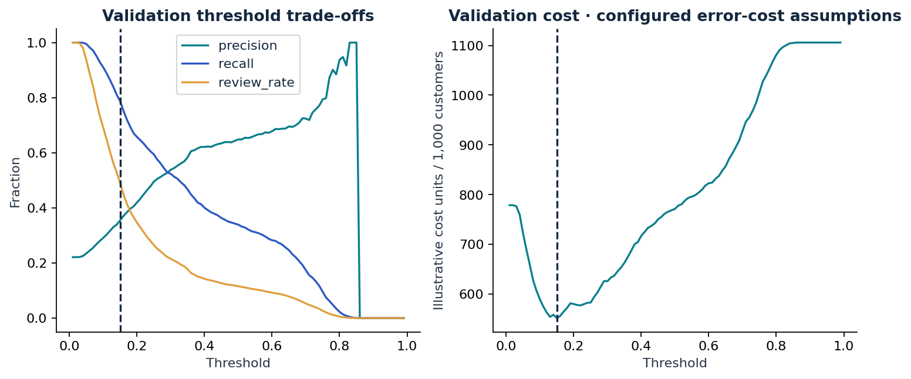

# Results and interpretation

**Validation-selected model: XGBoost.** On 6,000 held-out accounts: average precision **0.581**, ROC-AUC **0.793**, Brier score **0.131**. At the frozen threshold **0.15**, recall is **79.2%** and **48.5%** of accounts are flagged. The threshold uses an illustrative missed-default:false-alarm cost ratio of 5:1.

95% customer-bootstrap intervals: AP 0.551–0.607; ROC-AUC 0.778–0.807. These intervals condition on the fitted model; they do not measure future drift or model-selection uncertainty.

## What was selected, and when?

The six learned models were tuned using 3-fold stratified cross-validation on
18,000 training accounts. Their tuned candidates were compared on 6,000 validation
accounts using average precision. The initial winning family was **XGBoost**.
The selected family's optional calibration was decided using validation Brier
score, with calibration fitted on training folds. Recorded calibration: **none**.
The policy threshold was then selected on validation data under a 5:1 cost ratio.
Model, calibration and threshold were fixed before the final 6,000-account assessment.

## Complete model comparison

| Model | Selection val AP | Test AP | Test ROC-AUC | Test Brier ↓ |
| --- | --- | --- | --- | --- |
| XGBoost | 0.5459 | 0.5812 | 0.7928 | 0.1311 |
| Random forest | 0.5422 | 0.5705 | 0.7857 | 0.1330 |
| L1 logistic (lasso) | 0.5230 | 0.5538 | 0.7793 | 0.1342 |
| L2 logistic (ridge) | 0.5228 | 0.5534 | 0.7792 | 0.1343 |
| Decision tree | 0.5026 | 0.5417 | 0.7749 | 0.1360 |
| RBF SVM | 0.5022 | 0.5335 | 0.7386 | 0.1426 |
| Prevalence baseline | — | 0.2212 | 0.5000 | 0.1723 |

Rows are ordered by **initial validation selection AP**, not final test score.
The champion's test row uses its final calibration; other model rows use their
tuned fitted candidate. Thus the selection AP and final calibrated AP can differ.
All test comparisons are descriptive. The project does not reselect a winner from this table.
AP is average precision, not accuracy or trapezoidal precision–recall area.
The baseline predicts training prevalence for every customer; its AP is test prevalence.

## Decision consequences

At the frozen policy, the test confusion counts are TN=2,816, FP=1,857, FN=276, TP=1,051. Precision is 36.1%; recall is 79.2%. The illustrative error cost is 539.5 units per 1,000 accounts, compared with 1105.8 for flagging none and 778.8 for flagging all. This comparison is a consequence of assumed classification costs. It is not measured money saved or evidence that reviewing an account prevents default.

The cost-selected policy is not capacity constrained: it flags 48.5% of test accounts. Under a separately prespecified top-10% ranking budget (600 accounts), precision is 72.3% and recall is 32.7%. This is a ranking benchmark with stable tie-breaking, not an estimated intervention benefit.

## Did engineered features help?

| features | mean_cv_average_precision | std_cv_average_precision |
| --- | --- | --- |
| original_only | 0.5562 | 0.0082 |
| original_plus_engineered | 0.5632 | 0.0089 |

Engineered minus original training-CV AP: **+0.0070**. This is an exploratory,
fixed-parameter ablation: hyperparameters were tuned with engineered features.
It is not an independently tuned comparison or an unbiased confirmatory estimate.
A small or negative improvement is a useful result; the feature set was not rewritten after inspecting test scores.

## Explanations and subgroup diagnostics

Permutation importance measures how validation AP changes when a raw input is
shuffled and all derived features are recomputed. Correlated inputs can share or
mask importance. It does not identify causes of default. `subgroup_metrics.csv`
reports sample sizes, class prevalence, recall and false-positive rates by sex
and age. Small groups are unstable; no fairness or regulatory certification is claimed.

## What the results do not establish

No future-period or external-bank validation is available in this dataset.
Bootstrap intervals are conditional on this fitted model and historical cohort.
Validation has supported several decisions, so its scores can be optimistic.
No customer intervention, recovery or realized economic benefit is observed.
Before an operational pilot: secure suitable contemporary data, conduct external
and temporal validation, review feature and fairness policies with domain experts,
and test intervention effects prospectively.

Study mode: **full**. Seed: **42**.
Full environment and archive fingerprint: `reports/summary.json` and `reports/provenance.json`.
